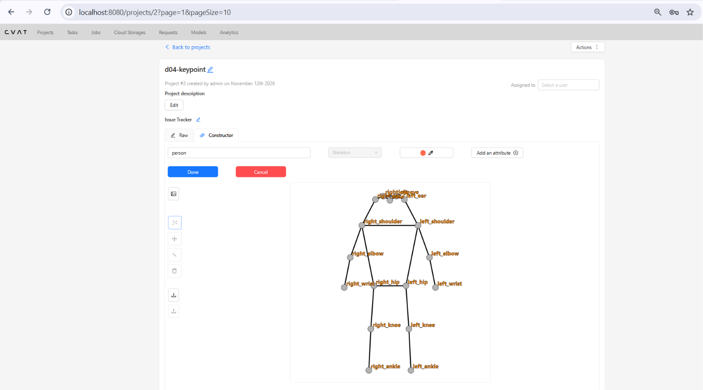
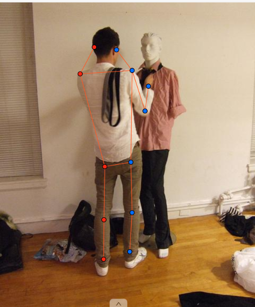
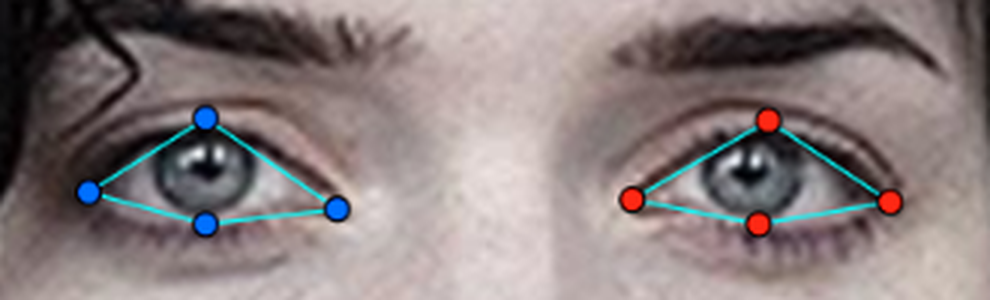
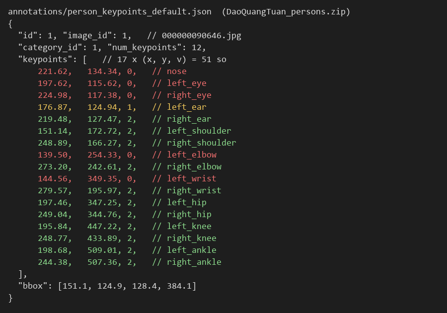

# Báo cáo cá nhân — DaoQuangTuan-2A202603194

Dữ liệu: 12 ảnh người COCO val2017 (Lin et al., 2014) và 8 ảnh chân dung Wikimedia Commons, chỉ dùng trong lớp.

## 0. Thông tin học viên

- Họ tên: Đào Quang Tuấn
- MSSV: 2A202603194
- Email: daotuan6325@gmail.com
- Link repository: https://github.com/DaoTuan439/K5-L2-DAY04-DaoQuangTuan-2A202603194-KeypointPose
- Phiên bản CVAT (Help → About): 2.82.1
- Máy: hệ điều hành Windows 11 · RAM 16 GB · chạy CVAT
- Bộ ảnh (`src/exports/assignment.json` do `lab.py setup` tạo): có
- Giờ bắt đầu: 17:00
- Giờ kết thúc: 19:00

## 1. Kiểm tra label (CP0)

| Label    | Kiểu     | Số điểm | Tên điểm đúng bảng của lab? | Đúng thứ tự? | Số cạnh |
| -------- | -------- | ------: | --------------------------- | ------------ | ------: |
| `person` | Skeleton |      17 | Có                          | Có           |      19 |
| `face`   | Skeleton |      13 | Có                          | Có           |      13 |

Mẫu `person` dựng theo người quay mặt về camera (các điểm `left_*` nằm bên phải khung mẫu)? Có

Cách đổi cờ `occluded` / `outside` cho **một điểm** trên phiên bản CVAT này (một câu):

Rê chuột vào đúng điểm cần đổi (điểm sáng lên) rồi bấm `Q` để bật `occluded` hoặc `O` để bật `outside` (hoặc chuột phải vào điểm, chọn nút tương ứng trong menu 4 nút, hoặc bấm biểu tượng ở dòng của điểm đó trong panel Objects); chỉ điểm đó đổi cờ, bấm lại phím để tắt, không dùng `H` (hidden) vì cờ này không được lưu.

## 2. Số lượng đã gán và thời gian (CP1, CP2)

| Nhóm ảnh   | Số ảnh | Số skeleton đã gán | Số người dưới 60 px (không gán) | Số poster / gương / màn hình bỏ qua | Thời gian (phút) |
| ---------- | -----: | -----------------: | ------------------------------: | ----------------------------------: | ---------------: |
| `easy`     |      5 |                  5 |                               0 |                                   0 |                — |
| `occluded` |      3 |                  5 |                               0 |              1 (ma-nơ-canh, 090646) |                — |
| `back`     |      2 |                  4 |                               0 |                                   0 |                — |
| `small`    |      1 |                  3 |                               0 |                                   0 |                — |
| `crowd`    |      1 |                  3 |                               0 |                                   0 |                — |
| `faces`    |      8 |                  8 |                               — |                                   0 |              ~30 |

Tổng: 20 skeleton `person` trên 12 ảnh, 8 skeleton `face` trên 8 ảnh. Thời gian không ghi tách theo từng nhóm ảnh người; gán 12 ảnh người hết khoảng 70 phút.

- Số ảnh người đã xong ở mốc phút 105: không ghi lại / 10 (buổi làm bắt đầu 17:00, kết thúc 19:00)
- Thời gian thực tế (phút, ước lượng): CP1 ~70 · CP2 ~30 · CP3 ~20 (tổng 120 phút, 17:00–19:00)
- Ảnh tốn thời gian nhất là ảnh nào, vì sao?

000000106051: ảnh nhỏ, ba người đứng lẫn với ngựa và cỏ; người áo xanh ngọc bị người áo tím che gần hết và người đàn ông đứng nghiêng, nên mất nhiều thời gian để xác định hướng từng người và quyết định trái/phải.

## 3. Bảng ca khó (CP1, CP2)

Mỗi điểm bạn phân vân một dòng, nhất là phân vân giữa `v = 1` và `v = 0`, hoặc không chắc hướng người.

| Ảnh | Người / mặt | Điểm | Cờ đã chọn | Phân vân giữa | Lý do chọn |
| --- | ----------- | ---- | ---------: | ------------- | ---------- |
| 000000090646 | Người quay lưng chỉnh cà vạt | `left_ear` | `v = 1` | `v = 1` / `v = 0` | Tai trái khuất sau gáy, nhưng ước lượng chắc được vị trí từ hình dạng đầu và đối xứng với tai phải đang thấy |
| 000000106051 | Người áo xanh ngọc đứng sau người áo tím (chỉ thấy hai vai) | Hướng người (toàn bộ `left_*` / `right_*`) | Quay mặt về camera | Quay mặt / quay lưng | Có dấu hiệu cho thấy người này quay về phía camera nên gán theo hướng quay mặt; đầu bị che nên hướng không chắc chắn hoàn toàn, cần hỏi coach |
| face_223746 | Mặt nghiêng, nhìn sang trái ảnh | 2 điểm của mắt phải (mắt phía xa) | `v = 1` | `v = 1` / `v = 0` | Sống mũi che một phần mắt phía xa nhưng vẫn thấy đủ để ước lượng chắc vị trí khóe và mí |

## 4. Bảng tự review (CP3)

Đi từ ảnh cuối về ảnh đầu. 5 ảnh người (ít nhất 2 ảnh `back` hoặc `crowd`) và 3 ảnh mặt. Ít nhất 8 dòng, kể cả dòng `ok`. Ghi lỗi trước, sửa sau.

Mã lỗi dùng đúng một trong: `lr_swap`, `vis_flag`, `position`, `missing`, `extra`, `ok`.

| Ảnh | Người / mặt | Điểm | Mã lỗi | Ghi chú | Đã sửa? |
| --- | ----------- | ---- | ------ | ------- | ------- |
| 000000558066 | Người 1 (tay vợt, quay mặt) | `left_shoulder`, `right_shoulder` | `position` | Hai điểm vai đặt ở cổ áo; kéo ra tâm khớp vai (đầu xương cánh tay) | Có |
| 000000106051 | Người áo tím (quay lưng) | Cả người | `lr_swap` | Người quay lưng nhưng gán như quay mặt (`left_*` nằm bên phải ảnh); đổi lại `left_*` sang bên trái ảnh | Có |
| 000000381889 | 2 người chưa gán | Cả người | `missing` | Thiếu 2 người cao từ 60 px trong ảnh đông người; đã gán thêm 2 skeleton | Có |
| 000000106051 | Người đàn ông bên phải (nghiêng, nhìn sang trái ảnh) | Tai, vai, khuỷu, cổ tay phía gần camera | `lr_swap` | Nhìn sang trái ảnh thì bên gần camera là bên trái của người, nhưng đang gán `right_*` (`v = 2`) ở bên gần và `left_*` = `v = 0` ở bên xa | Không, phát hiện khi review nhưng chưa kịp sửa trước khi xuất |
| 000000106051 | Người áo tím (quay lưng) | `nose`, `right_eye` | `vis_flag` | Người quay lưng, không thấy mặt nhưng mũi và mắt phải vẫn `v = 2`; lẽ ra là `outside` (`v = 0`) | Không, chưa kịp sửa |
| 000000518966 | Người 1 (bị cắt ở mép phải) | `left_hip` | `vis_flag` | `v = 2` tại x = 426 trên ảnh rộng 427 px, tức điểm bị kéo về mép; hông thật nằm ngoài khung, lẽ ra là `outside` (`v = 0`) | Không, chưa kịp sửa |
| face_562485 | Mặt thẳng, tóc che một phần | 13 điểm | `ok` | `left_eye_*` bên phải ảnh; mí trên/dưới đặt sát mép mí ngay trên/dưới con ngươi; tóc không che mắt nên giữ `v = 2` | — |
| face_223746 | Mặt nghiêng, nhìn sang trái ảnh | 13 điểm | `ok` | Mắt phải (bên xa) bị sống mũi che một phần, đặt `occluded` (`v = 1`); mắt trái, chóp mũi, khóe miệng đúng bên | — |
| face_219250 | Mặt đeo kính râm tối | 13 điểm | `ok` | 8 điểm mắt sau tròng kính là `occluded` (`v = 1`), đặt theo gọng; `mouth_left` bên phải ảnh | — |

Tổng hợp số lỗi theo mã:

| `lr_swap` | `vis_flag` | `position` | `missing` | `extra` | `ok` |
| --------: | ---------: | ---------: | --------: | ------: | ---: |
|         2 |          2 |          1 |         1 |       0 |    3 |

Điểm còn phân vân giữa `v = 1` và `v = 0` (ghi cả hai lựa chọn và lý do chọn):

Xem mục 3: `left_ear` ở 000000090646 và mắt phía xa ở face_223746 (chọn `v = 1`, lý do ghi trong bảng).

## 5. Kiểm file xuất và kết quả tự kiểm (CP4)

Tự kiểm tay trong file JSON (`annotations/person_keypoints_default.json` trong mỗi zip):

| File                       | Người / mặt kiểm (ảnh, thứ tự)            | Số phần tử `keypoints` | Điểm `outside` ra `v = 0`, `occluded` ra `v = 1`?                                               | `num_keypoints` khớp?           |
| -------------------------- | ----------------------------------------- | ---------------------: | ----------------------------------------------------------------------------------------------- | ------------------------------- |
| `DaoQuangTuan_persons.zip` | 000000090646, người 1 (quay lưng)         |                     51 | Có: 5 điểm `outside` (mũi, 2 mắt, khuỷu + cổ tay trái) ra `v = 0`, 1 điểm `occluded` ra `v = 1` | Có: 11 (`v=2`) + 1 (`v=1`) = 12 |
| `DaoQuangTuan_persons.zip` | 000000518966, người 1 (bị cắt ở mép phải) |                     51 | Có: 12 điểm `v = 0`, 1 điểm `v = 1` (`left_ear`)                                                | Có: 4 + 1 = 5                   |
| `DaoQuangTuan_faces.zip`   | face_219250 (kính râm tối)                |                     39 | Có: 8 điểm mắt sau kính `occluded` ra `v = 1`                                                   | Có: 5 + 8 = 13                  |

Sau khi xuất, CVAT ghi `occluded` thành `v = 1` và `outside` thành `v = 0`. Tọa độ của điểm `outside` trong file là `0, 0` hay tọa độ cũ? Tọa độ cũ (ví dụ 000000518966 người 1: `nose` = `534, 114, 0`, nằm ngoài ảnh rộng 427 px). Điểm `v = 0` bị bỏ qua khi huấn luyện và khi chấm nên không ảnh hưởng.

Hai job đã chuyển sang completed trên CVAT? Có

Dán phần **TÓM TẮT** in ra từ `src/check_submission.py`:

```text
- File person: DaoQuangTuan_persons.zip
  Số ảnh: 12 · số skeleton `person`: 20 · mỗi annotation 51 số
  Skeleton theo ảnh: 000000090646=1, 000000106051=3, 000000156069=1, 000000261732=1, 000000294329=1, 000000302102=2, 000000336477=1, 000000381889=3, 000000391222=2, 000000467300=2, 000000518966=2, 000000558066=1
  Cờ v: v=2 232 (68%) · v=1 26 (8%) · v=0 82 (24%)
  num_keypoints trung bình: 12.9
- File face: DaoQuangTuan_faces.zip
  Số ảnh: 8 · số skeleton `face`: 8 · mỗi annotation 39 số
  Skeleton theo ảnh: face_219250=1, face_223746=1, face_249336=1, face_300399=1, face_3348=1, face_416730=1, face_469647=1, face_562485=1
  Cờ v: v=2 94 (90%) · v=1 10 (10%) · v=0 0 (0%)
  num_keypoints trung bình: 13.0
- Ghi chú: 82 điểm v = 0 vẫn mang tọa độ cũ (CVAT 2.x xuất như vậy; chuẩn COCO ghi 0, 0). Không phải lỗi: điểm v = 0 bị bỏ qua khi huấn luyện và khi chấm.
- Số [LỖI]: 0 · số [CẢNH BÁO]: 2
Kết quả: ĐẠT (đọc lại từng cảnh báo ở trên)
```

Các `[CẢNH BÁO]` còn giữ nguyên và lý do:

- `000000106051.jpg #2: các điểm chỉ trải cao 26 px`: giữ nguyên. Đây là người áo xanh ngọc đi sau người áo tím; người thật cao hơn 60 px nhưng bị người phía trước che gần hết, chỉ thấy hai vai nên các điểm `v > 0` chỉ trải 26 px. Đúng trường hợp script cho phép bỏ qua (người cao hơn nhưng bị che/cắt).
- `000000518966.jpg #1: left_hip v = 2 nằm sát mép ảnh (426, 352)`: chưa sửa. Ảnh rộng 427 px, người này bị cắt ở mép phải; hông trái nhiều khả năng nằm ngoài khung và lẽ ra phải là `outside` (`v = 0`). Đây là lỗi `vis_flag` đã nhận ra nhưng chưa sửa trước khi xuất lần cuối.

## 6. Ảnh chụp màn hình

1. Label `person` trong label constructor (đủ 17 điểm có tên):

   

2. Một người quay lưng đã gán, cờ đã đặt:

   

3. Một khuôn mặt đã gán 13 điểm, phóng to vùng mắt:

   

4. Một đoạn JSON xuất của một người:

   

Nguồn ảnh: COCO val2017 / Wikimedia Commons.

## 7. Tự đánh giá

1. Lỗi bạn mắc nhiều nhất hôm nay, và cách bạn sẽ tránh ở dự án thật:

   Lỗi `position`: điểm lệch khỏi tâm khớp. Ví dụ ở ảnh 000000558066 tôi đặt hai vai ở cổ áo thay vì ở khớp vai, và lúc đầu ở ảnh 000000090646 có điểm rơi sang ma-nơ-canh đứng cạnh người. Ở dự án thật tôi sẽ phóng to trước khi đặt điểm; đặt theo xương và khớp chứ không theo viền quần áo; sau mỗi người kiểm lại đường nối (vai → khuỷu phải chạy dọc giữa cánh tay trên, toàn bộ skeleton phải nằm gọn trên đúng một người).

2. Một quy tắc bạn đề xuất thêm vào guideline (kèm ảnh ví dụ nếu có):

   Thêm hướng dẫn cho người chỉ lộ vai, không thấy cả mặt lẫn gáy (ví dụ người áo xanh ngọc đứng sau người áo tím ở ảnh 000000106051). Guideline hiện bảo "nói hướng người trước khi đặt điểm", nhưng không nói phải làm gì khi không có mũi, mắt hay gáy để dựa vào. Đề xuất: dựa vào hướng di chuyển của nhóm và người đứng cạnh, dáng vai, hướng mũi bàn chân nếu thấy; nếu vẫn không chắc thì giữ hướng đã chọn, ghi vào bảng ca khó và hỏi coach, để mọi người gán cùng một cách.

3. Nhãn của bạn đi vào model ở đâu? Chọn một lỗi bạn đã sửa và nói nó sẽ làm model học sai thế nào (heatmap, trọng số trong loss, hay bước lật ảnh):

   Lỗi `lr_swap` ở người áo tím quay lưng trong ảnh 000000106051. Mỗi điểm `v > 0` thành một đỉnh trên heatmap của đúng tên điểm đó, nên khi đổi trái/phải thì heatmap `left_shoulder`, `left_hip`… có đỉnh nằm ở khớp bên phải, và với trọng số 1 trong loss model bị dạy rằng người quay lưng có bên trái nằm bên phải ảnh. Khi lật ảnh để tăng dữ liệu, cặp trái/phải lại được đổi tên thêm lần nữa, nên cùng một dáng người có hai nhãn mâu thuẫn nhau. Khi chấm OKS, điểm nằm đúng khớp nhưng sai tên bị tính như lệch cả bề ngang người, nên OKS của người đó sụp xuống.

## 8. Khó khăn và lỗi kỹ thuật

- Không gặp lỗi CVAT làm mất dữ liệu. Lần xuất đầu tiên có 6 ảnh người và 4 ảnh mặt ra 0 skeleton vì lúc đó tôi chưa gán xong; gán tiếp, `Ctrl+S` rồi xuất lại thì đủ.
- Kết quả xuất chỉ thay đổi sau khi đã lưu job (`Ctrl+S`); sửa trên giao diện mà chưa lưu thì `lab.py export` vẫn ra nhãn cũ.
- Điểm `outside` vẫn giữ tọa độ cũ trong file xuất (không phải `0, 0`), đúng như ghi chú của lab.

## Bonus (nếu làm)

Làm **B1** và **B2** (task `persons-extra-DaoQuangTuan`, `faces-extra-DaoQuangTuan`). File: `src/exports/DaoQuangTuan_bonus_persons.zip`, `src/exports/DaoQuangTuan_bonus_faces.zip`.

### B1 — 3 ảnh người khó

| Ảnh | Số skeleton | Ca khó | Cách xử lý |
|---|---:|---|---|
| 000000188948 | 3 | 1 người quay lưng ở gần camera, mất chân dưới khung; 2 người đứng nghiêng chồng lên nhau, người áo đỏ bị che gần hết | Người quay lưng: `left_*` bên trái ảnh, cổ chân ngoài khung → `O`; người nghiêng nhìn sang phải ảnh → gán phía phải (phía gần camera), phía xa → `O` |
| 000000213506 | 2 | Hai người chồng nhau: bé gái quay lưng đứng che chị áo đen đứng nghiêng | Bé gái: quay lưng; chị áo đen: nhìn về trái ảnh nên bên trái là bên gần camera |
| 000000323525 | 3 | Trọng tài và bắt bóng ngồi xổm chồng lên nhau, người nhỏ (~80–140 px), lưới che phía trước | Cả 3 người quay lưng về camera → `left_*` bên trái ảnh; khớp bị người kia che → `Q` |

Kết quả tự kiểm (`python src/check_submission.py --persons ...bonus_persons.zip --faces ...bonus_faces.zip --expected-person-images 3 --expected-face-images 5`):

```
- File person: DaoQuangTuan_bonus_persons.zip
  Số ảnh: 3 · số skeleton `person`: 8 · mỗi annotation 51 số
  Skeleton theo ảnh: 000000188948=3, 000000213506=2, 000000323525=3
  Cờ v: v=2 81 (60%) · v=1 8 (6%) · v=0 47 (35%)
- File face: DaoQuangTuan_bonus_faces.zip
  Số ảnh: 5 · số skeleton `face`: 5 · mỗi annotation 39 số
  Cờ v: v=2 63 (97%) · v=1 2 (3%) · v=0 0 (0%)
- Số [LỖI]: 0 · số [CẢNH BÁO]: 1
Kết quả: ĐẠT
```

Cảnh báo `000000213506.jpg #2` (nghi `lr_swap` cả người): giữ nguyên. Chị áo đen đứng nghiêng, mặt nhìn về phía trái ảnh nên bên trái của chị là bên gần camera; `left_*` nằm bên trái ảnh là đúng, không phải gán như người quay lưng.

Lỗi đã biết khi review lại, chưa sửa do hết giờ:
- 000000213506 #2: `right_elbow`, `right_wrist` đặt nhầm lên tay bé gái phía trước (`position`, đúng ra phải `O`).
- 000000213506: thiếu người phụ nữ ở cửa sổ tầng trên (`missing`).
- 000000213506 #1: hai điểm hông đặt hơi thấp (`position`).

### B2 — 5 ảnh khuôn mặt đen trắng

5/5 mặt, đủ 13 điểm. Ảnh không màu khó hơn ảnh màu ở chỗ: mép mí và khóe miệng không còn khác màu với da, chỉ còn dựa vào độ sáng tối nên dễ đặt mí dưới lệch xuống vùng bọng mắt; môi trên lẫn vào ria mép (face_274219 phải để hai khóe miệng là `v = 1`); ảnh cũ có hạt nhiễu (face_296417) làm mép mí bị nhòe. Về kính: ở face_317330 tròng kính tối nhưng vẫn nhìn xuyên thấy mắt nên tôi để `v = 2`. Với kính râm trên ảnh hồng ngoại, nhiều loại tròng cho tia hồng ngoại đi qua nên mắt thường vẫn thấy được → `v = 2`; chỉ khi tròng tối hẳn, không thấy mép mắt mới để `v = 1`.

Lỗi đã biết, chưa sửa: face_317330 — ông cụ nhìn qua phía trên gọng kính, 4 điểm `left_eye_*` đặt trên mặt kính, thấp hơn mắt thật khoảng 30 px (`position`).

## 9. Tài liệu tham khảo và công cụ AI đã dùng

- Tài liệu của lab: `README.md`, `RULES.md`, `CHECKPOINTS.md`, `docs/GUIDELINE.md`, `docs/CVAT_CHEATSHEET.md`, `docs/COCO_KEYPOINTS.md`.
- Claude Code (trợ lý AI): giải thích quy tắc trái/phải và cờ visibility; chỉ ra lỗi trên ảnh chụp màn hình khi tôi tự review (vị trí vai, đổi trái/phải, cờ `v`); giải thích các `[CẢNH BÁO]` của `src/check_submission.py`; hỗ trợ trình bày các mục 0, 1, 2, 5, 8 từ dữ liệu xuất thật. Toàn bộ điểm trong hai job do tôi tự gán tay trên CVAT. Ở mục 3, 4, 7, nội dung (lỗi nào, cờ nào, lý do chọn, lỗi mắc nhiều nhất, đề xuất) là của tôi; AI chỉ hỗ trợ trình bày thành câu chữ và bảng. Ảnh `4_json_export.png` được dựng lại từ file JSON đã xuất. Phần Bonus: điểm B1, B2 do tôi tự gán tay; AI vẽ lại nhãn từ file xuất để chỉ ra lỗi và hỗ trợ trình bày bảng B1, đoạn nhận xét B2.
